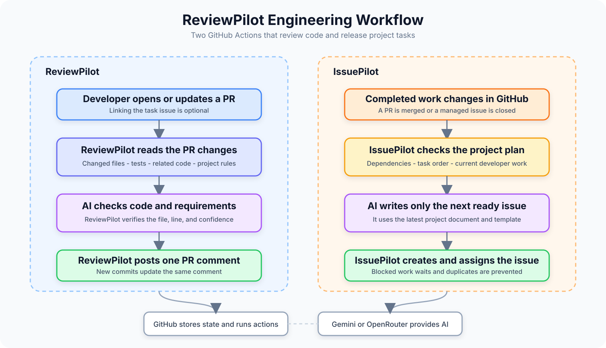
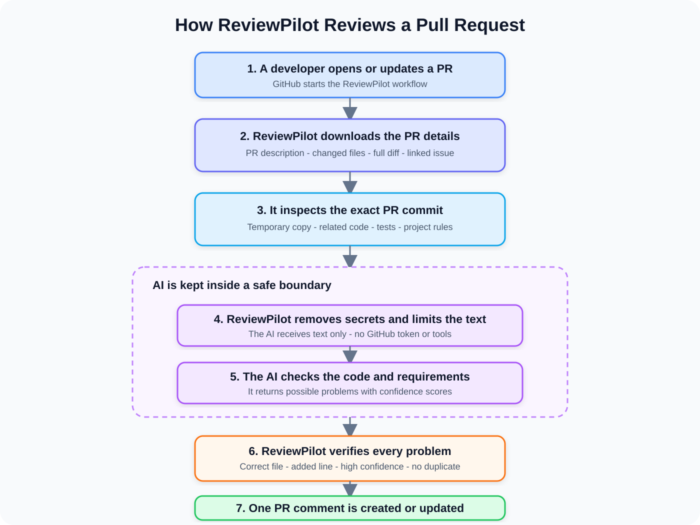
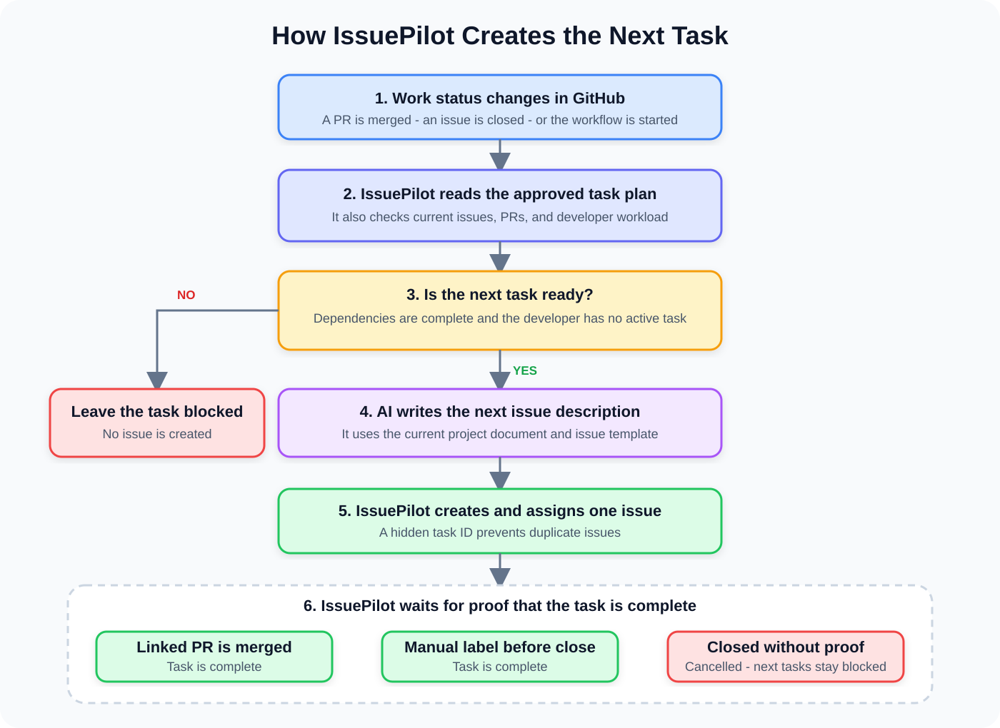

# Architecture

ReviewPilot is a TypeScript CLI exposed through two composite GitHub Actions. GitHub stores project state and triggers each run, so the system needs no database or always-on server.

## System overview

The two agents share the GitHub API and model-provider layer, but they have different responsibilities:

- ReviewPilot reads code and writes one marked PR comment plus local reports.
- IssuePilot reads an approved roadmap and creates eligible GitHub issues.

## ReviewPilot flow

### Repository context

`src/github.ts` retrieves pull-request metadata, changed files, the complete diff, optional linked issues, and any existing ReviewPilot comment.

`src/git.ts` creates a temporary checkout at the exact PR head commit. Authentication is passed through the process environment and is never added to the clone URL.

`src/repository.ts` collects a limited set of useful context:

- repository instruction files;
- project manifests;
- changed files;
- matching tests; and
- files that reference changed symbols.

The agent does not build a permanent copy or index of the repository.

### Model and verification boundary

`src/providers.ts` selects Gemini or OpenRouter and can use the configured fallback provider. Both providers return the same structured review format.

The model does not publish comments directly. ReviewPilot rejects:

- findings below the confidence threshold;
- duplicate findings;
- findings for files that do not exist;
- findings for lines that were not added by the PR; and
- findings without a location, unless they describe a missing linked requirement.

This keeps the model useful while preventing unsupported feedback from reaching the pull request.

### Reports and comment updates

`src/report.ts` creates Markdown and JSON reports. The GitHub comment includes a hidden stable marker. On later runs, ReviewPilot updates only its own marked comment and never edits a normal user comment.

## IssuePilot flow

### Approved inputs

The target repository provides:

- `.issuepilot/config.yml` for the repository, labels, documents, and team mapping;
- `.issuepilot/plan.yml` for ordered tasks, assignees, and dependencies;
- a project document containing current product and technical decisions; and
- an issue template describing the required task format.

The roadmap is written and reviewed by people. IssuePilot validates it but does not create or rewrite it.

### Scheduling rules

`src/issuepilot/sync.ts` rebuilds task progress from GitHub on every run. A task is ready only when:

1. all dependencies are complete;
2. every earlier task for the same assignee is complete;
3. the assignee has no managed task in progress; and
4. no other task for that assignee was selected during the same run.

This limits each synchronization run to one new issue per available assignee.

### Completion and cancellation

A task is complete when:

- a pull request that closes its issue is merged; or
- the issue is closed with the configured manual-completion label.

Closing an issue without either signal marks it as cancelled. A cancelled task does not unlock dependent tasks.

### Just-in-time issue descriptions

Future issue bodies are not stored in the roadmap. When a task becomes ready, `src/issuepilot/generator.ts` combines the approved task summary with the latest project document, issue template, and dependency state.

The new issue receives a hidden task marker. Later runs use this marker to find the task reliably and prevent duplicate issues.

## State and memory

| State                    | Location                          | Purpose                                               |
| ------------------------ | --------------------------------- | ----------------------------------------------------- |
| Pull requests and issues | GitHub                            | Source of truth for workflow events and task progress |
| IssuePilot roadmap       | Target repository                 | Human-approved task order and dependencies            |
| Task identity            | Hidden issue marker               | Maps a plan task to its GitHub issue                  |
| Review identity          | Hidden PR-comment marker          | Ensures one ReviewPilot comment per PR                |
| Review cache             | `.reviewpilot/memory.json`        | Reuses an exact completed review                      |
| Temporary code context   | Operating-system temporary folder | Exists only during a review                           |

The review cache contains completed results and report metadata. It does not store repository snapshots or credentials.

## Failure handling

- Temporary provider failures are retried.
- Invalid model output is rejected instead of being partly applied.
- GitHub write failures stop the workflow with a clear error.
- Temporary checkouts are removed in a `finally` path.
- Issue state is reconstructed from GitHub on the next run.
- IssuePilot supports a dry run that evaluates scheduling without creating issues.

See [TROUBLESHOOTING.md](TROUBLESHOOTING.md) for recovery steps.

## Trust boundaries

The model receives redacted, size-limited text. It receives no shell access, GitHub token, or direct write capability.

GitHub writes are limited to:

- one marked ReviewPilot pull-request comment; and
- IssuePilot labels and issues represented in the approved roadmap.

Neither agent can push code, approve reviews, request changes, or merge pull requests. See [SECURITY.md](SECURITY.md) for the full security model.
