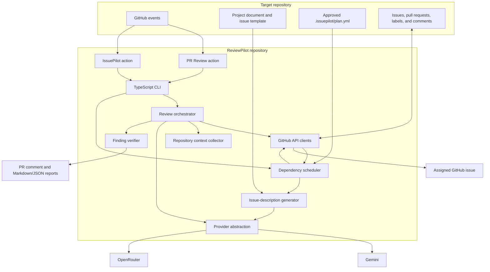
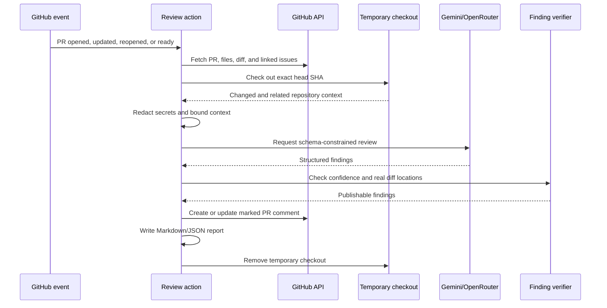

# Architecture

ReviewPilot is a TypeScript CLI exposed through two composite GitHub Actions. It deliberately has no database or always-on service: GitHub owns workflow events and project state, while local JSON files cache completed reviews.

## Component map

## ReviewPilot execution

### Input acquisition

`src/github.ts` parses GitHub references and retrieves pull-request metadata, file metadata, unified diffs, optional linked issues, and existing review comments.

`src/git.ts` creates a temporary checkout at the exact PR head SHA. Authentication is passed through the subprocess environment instead of being embedded in the clone URL.

`src/repository.ts` gathers bounded context from:

- repository instruction files;
- the project manifest;
- changed files;
- matching tests; and
- files that reference changed symbols.

The context is intentionally bounded rather than indexing the entire repository.

### Model and verification boundary

`src/providers.ts` selects the primary model provider and performs configured fallback. Gemini and OpenRouter clients must return the same structured review shape.

The model does not decide what is published directly. `verifyFindings` rejects:

- findings below the configured confidence threshold;
- duplicate findings;
- findings pointing to a nonexistent file;
- findings pointing to a line that was not added by the PR; and
- location-free findings unless linked requirements are present and the category is requirements-related.

This boundary reduces unsupported model feedback while retaining the ability to report a requirement that the PR omitted entirely.

### Reports and comment identity

`src/report.ts` renders local Markdown and JSON reports and embeds a stable hidden marker in the GitHub comment. On another run, ReviewPilot updates only a marked comment authored by the current token identity. It never edits arbitrary user comments.

## IssuePilot execution

```mermaid
stateDiagram-v2
    [*] --> Planned
    Planned --> Blocked: dependency incomplete
    Planned --> Blocked: earlier or active assignee task
    Blocked --> Planned: GitHub state changes
    Planned --> Ready: all gates pass
    Ready --> InProgress: issue created
    InProgress --> Completed: merged closing PR
    InProgress --> Completed: closed with manual-completion label
    InProgress --> Cancelled: closed without completion evidence
    Completed --> [*]
    Cancelled --> [*]
```

### Approved inputs

The target repository supplies:

- `.issuepilot/config.yml` for repository, labels, project documents, and team mapping;
- `.issuepilot/plan.yml` for ordered tasks, assignments, dependencies, and existing-work mappings;
- a project document for current product and technical decisions; and
- an issue template describing the required issue format.

The roadmap is authored manually and approved through the repository's normal pull-request process. IssuePilot validates but never generates or rewrites it.

### Scheduling gates

`src/issuepilot/sync.ts` reconstructs task progress from the current GitHub state on every run. A planned task becomes ready only when:

1. every dependency is complete;
2. every earlier planned task for the same assignee is complete;
3. the assignee has no other managed task in progress; and
4. no other task for that assignee has been selected during the same run.

At most one new issue per assignee is therefore created during synchronization.

### Completion and cancellation

A task is complete only when a PR that closes its issue is merged, or when the issue is closed with the configured manual-completion label. Closing an issue without either signal makes it cancelled, which keeps dependent tasks blocked.

### Just-in-time descriptions

Future issue bodies are not stored in the roadmap. When a task becomes ready, `src/issuepilot/generator.ts` combines its approved summary with the latest project document, issue template, and dependency state. The generated body receives a hidden task marker before publication, allowing later runs to identify it without relying on titles.

## State and memory

| State                  | Location                   | Purpose                                                  |
| ---------------------- | -------------------------- | -------------------------------------------------------- |
| PR and issue state     | GitHub                     | Durable source of truth for review and scheduling events |
| IssuePilot roadmap     | Target repository          | Human-approved task order and dependencies               |
| Task identity          | Hidden issue-body marker   | Duplicate prevention and task-to-issue mapping           |
| Review identity        | Hidden PR-comment marker   | Updates one ReviewPilot comment                          |
| Review cache           | `.reviewpilot/memory.json` | Reuses an exact completed review                         |
| Temporary code context | OS temporary directory     | Exists only during a review and is removed afterward     |

The review cache stores completed report metadata and results, not repository source snapshots or credentials.

## Failure behavior

- Temporary provider failures are retried; a configured OpenRouter provider can follow Gemini.
- Invalid model output is rejected rather than partially applied.
- GitHub write failures stop the workflow with a typed error.
- Temporary checkouts are removed in a `finally` path.
- Issue creation is marker-based and state is reconstructed on the next run.
- A dry-run IssuePilot synchronization evaluates scheduling without creating issues.

Operational recovery steps are documented in [TROUBLESHOOTING.md](TROUBLESHOOTING.md).

## Trust boundaries

The model receives redacted, size-limited text context. It receives no tool access, shell access, GitHub token, or direct write capability.

GitHub writes are limited to:

- one marked ReviewPilot pull-request comment; and
- IssuePilot labels and issues represented by the approved roadmap.

Neither agent can push code, approve reviews, request changes, or merge pull requests. See [SECURITY.md](SECURITY.md) for the complete security model.
