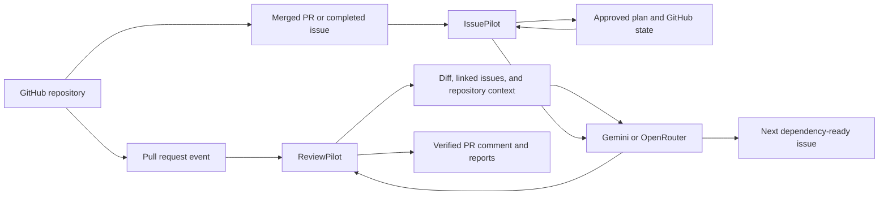

# ReviewPilot

[](https://github.com/nandu-99/reviewpilot/actions/workflows/ci.yml)
[](https://github.com/nandu-99/reviewpilot/releases)
[](https://nodejs.org/)
[](LICENSE)

ReviewPilot is an AI-powered GitHub engineering workflow for repository-aware pull-request reviews and dependency-aware issue scheduling.

- **ReviewPilot** checks a PR at its exact commit, compares it with optional linked issues, rejects unverifiable findings, and maintains one concise review comment.
- **IssuePilot** follows a human-approved roadmap and creates the next eligible issue only after dependencies and the assignee's previous work are complete.

Both agents run in GitHub Actions. They do not require an always-on server and never push application code or merge pull requests.

## Why it is different

General-purpose assistants often review an isolated snippet or produce an unverified list of suggestions. ReviewPilot inspects the real diff, changed files, related code, repository instructions, and optional requirements. A code finding is published only when it points to an actual added line; missing requirements are reported separately.

IssuePilot complements review with controlled delivery. Its roadmap is maintained manually and approved through an ordinary pull request, while AI is used only to write the next task's detailed description from current project documentation.

## System at a glance



See [ARCHITECTURE.md](ARCHITECTURE.md) for component boundaries, state, and event flows.

## Key capabilities

### Pull-request review

- Checks out the exact PR head commit in a temporary workspace.
- Reads the full diff, changed files, relevant tests, related symbols, manifests, and repository instructions.
- Optionally compares implementation with issues linked by `Closes`, `Fixes`, or `Resolves`.
- Supports Gemini as the primary provider and OpenRouter as a provider or fallback.
- Uses structured model output and confidence thresholds.
- Rejects wrong-file, wrong-line, duplicate, and low-confidence findings.
- Redacts common secrets before model analysis or persistence.
- Produces Markdown and JSON reports.
- Creates or updates one marked PR comment instead of posting duplicates.
- Runs configured validation commands only with explicit local authorization.

### Dependency-aware issue scheduling

- Reads a manually maintained `.issuepilot/plan.yml` roadmap.
- Validates task IDs, assignments, dependencies, existing-issue mappings, and dependency cycles.
- Uses GitHub issues and merged closing PRs as durable progress state.
- Creates at most one eligible issue per developer.
- Waits when an assignee already has managed work in progress.
- Blocks tasks whose dependencies are incomplete or cancelled.
- Generates the full issue description just in time from the latest project document and template.
- Prevents duplicate issues with stable hidden task markers.
- Supports approved manual completion through a dedicated label.

## Requirements

- Node.js 22 or newer
- Git
- A Gemini API key, an [OpenRouter API key](https://openrouter.ai/keys), or both
- A GitHub token when accessing private repositories or writing comments/issues

Gemini free-tier submissions may be used by Google to improve its products. Use a provider and account appropriate for the sensitivity of the repository being processed.

## Five-minute PR review setup

In the target repository, add `GEMINI_API_KEY` under **Settings → Secrets and variables → Actions**. `OPENROUTER_API_KEY` is optional and can be used as a fallback.

Copy [`examples/reviewpilot.yml`](examples/reviewpilot.yml) to:

```text
.github/workflows/reviewpilot.yml
```

The workflow uses:

```yaml
uses: nandu-99/reviewpilot@v1
```

Opening or updating a same-repository pull request now triggers a review. The example workflow intentionally skips fork-origin PRs and grants only:

```yaml
permissions:
  contents: read
  issues: read
  pull-requests: write
```

Use an immutable release such as `nandu-99/reviewpilot@v1.3.0`, or a full commit SHA, when your supply-chain policy does not allow a moving major tag.

## Local review

```bash
npm install
cp .env.example .env
npm run build
```

Configure at least one provider in `.env`:

```env
AI_PROVIDER=gemini
GEMINI_API_KEY=replace-me
GEMINI_MODEL=gemini-2.5-flash

# Optional fallback
OPENROUTER_API_KEY=sk-or-v1-replace-me
OPENROUTER_FALLBACK_MODEL=openrouter/free
```

During development:

```bash
npm run dev -- review https://github.com/OWNER/REPOSITORY/pull/123
```

From the compiled CLI:

```bash
node dist/cli.js review https://github.com/OWNER/REPOSITORY/pull/123
```

Useful options:

```bash
npm run dev -- review <PR_URL> --post-comment
npm run dev -- review <PR_URL> --issue 42
npm run dev -- review <PR_URL> --no-linked-issues
npm run dev -- review <PR_URL> --focus correctness,security
npm run dev -- review <PR_URL> --provider openrouter --model openrouter/free
npm run dev -- review <PR_URL> --run-checks
npm run dev -- review <PR_URL> --force
```

Reports are written to `.reviewpilot/reviews/`. Reviews are cached by repository, PR number, exact head SHA, provider configuration, focus, thresholds, linked-issue content, and validation settings.

Public repositories can be read without a personal token during local reviews, subject to lower API rate limits. Private repositories need a fine-grained token restricted to the selected repositories. Publishing a PR comment requires `Pull requests: Read and write`.

## Requirement-aware reviews

Issue context is optional. ReviewPilot detects up to five closing references in the PR description:

```markdown
Closes #42
Fixes owner/other-repository#9
Resolves https://github.com/owner/repository/issues/15
```

An issue can also be supplied explicitly:

```bash
npm run dev -- review <PR_URL> --issue owner/repository#42
```

Use `--no-linked-issues` for a PR-only review. An explicit `--issue` remains active with that flag.

## IssuePilot setup

The target repository owns IssuePilot's source of truth:

```text
PROJECT_CONTEXT.md
ISSUE_FORMAT.md
.issuepilot/config.yml
.issuepilot/plan.yml
```

Copy [`issuepilot.config.example.yml`](issuepilot.config.example.yml) to `.issuepilot/config.yml`, then customize the repository and team:

```yaml
repository: acme/platform
projectDocument: PROJECT_CONTEXT.md
issueTemplate: ISSUE_FORMAT.md
managedLabel: issuepilot
manualCompletionLabel: completed-manually

team:
  - github: backend-developer
    role: backend
  - github: frontend-developer
    role: frontend
```

Create and review the roadmap manually:

```yaml
version: 3
project: Example Platform
repository: acme/platform
tasks:
  - id: build-backend-api
    title: Build the Backend API
    role: backend
    assignee: backend-developer
    summary: Implement the approved contract with validation, authorization, and focused tests.
    dependencies: []

  - id: integrate-frontend-api
    title: Integrate the Frontend API
    role: frontend
    assignee: frontend-developer
    summary: Connect the UI with loading, success, empty, and error states.
    dependencies:
      - build-backend-api
```

Copy [`examples/issuepilot-sync.yml`](examples/issuepilot-sync.yml) to `.github/workflows/issuepilot-sync.yml`. Merging the approved roadmap or a closing implementation PR triggers synchronization automatically.

A task completes when either:

- a PR containing `Closes #<issue-number>` is merged; or
- the issue is closed with the configured `completed-manually` label.

Closing an issue without either condition marks it cancelled and does not unlock dependent work.

Inspect scheduling without creating issues:

```bash
node dist/cli.js issuepilot sync
```

Apply the approved plan manually:

```bash
node dist/cli.js issuepilot sync --apply
```

## Configuration and validation

Copy [`reviewpilot.config.example.yml`](reviewpilot.config.example.yml) to `reviewpilot.config.yml` to customize review thresholds, context limits, ignored paths, and validation commands.

Validation commands are arrays rather than shell strings:

```yaml
validation:
  commands:
    - [npm, run, typecheck, --if-present]
    - [npm, test]
```

ReviewPilot never installs dependencies in the reviewed checkout. Commands execute directly without a shell, and destructive or network-download commands are blocked. Automatic workflows do not enable validation because pull-request code is untrusted.

## Safety boundaries

- ReviewPilot does not modify reviewed source code, approve PRs, request changes, merge, or push.
- IssuePilot creates only approved roadmap issues; it does not modify source code or generate the roadmap.
- Common credential files and token patterns are excluded or redacted.
- Temporary checkouts are removed after both success and failure.
- GitHub publishing uses explicit, least-privilege workflow permissions.
- Fork-origin PRs are skipped by the supplied automatic workflow.

Read the full policy and threat boundaries in [SECURITY.md](SECURITY.md).

## Development

```bash
npm ci --ignore-scripts
npm run check
npm run test:coverage
npm run build
```

The test suite mocks GitHub, Gemini, and OpenRouter responses and does not require credentials. Contribution guidance is in [CONTRIBUTING.md](CONTRIBUTING.md), common operational failures are covered in [TROUBLESHOOTING.md](TROUBLESHOOTING.md), and release history is recorded in [CHANGELOG.md](CHANGELOG.md).

## Current limitations

- Model quality and availability depend on the selected provider and quota.
- Large repositories are represented through bounded changed-file and related-file context rather than a complete semantic index.
- Automatic validation is intentionally disabled for untrusted PR workflows.
- The supplied workflow skips fork pull requests.
- IssuePilot requires a manually reviewed roadmap and does not decide product scope.
- Neither agent implements changes or merges pull requests.

## License

[MIT](LICENSE)
